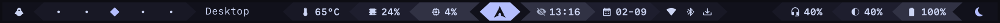
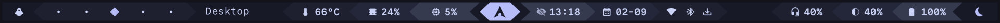
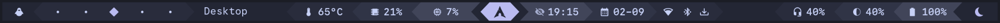

<div align="center">

## 🤖 mechabar

A <ins>mecha</ins>-themed Way<ins>bar</ins> configuration

|  |
| :---------------------------------------: |

<details>
<summary>Themes</summary>

| Catppuccin Mocha (default)                         |
| :------------------------------------------------: |
|  |

| Catppuccin Macchiato                                       |
| :--------------------------------------------------------: |
|  |

| Catppuccin Frappe                                    |
| :--------------------------------------------------: |
|  |

| Catppuccin Latte                                   |
| :------------------------------------------------: |
|  |

</details>
</div>

#

### Installation

1. Back up your existing Waybar configuration:

	```sh
	mv ~/.config/waybar ~/.config/waybar.bak
	```

2. Clone the repository into <ins>~/.config/waybar</ins>:

	```sh
	git clone https://github.com/sejjy/mechabar.git ~/.config/waybar
	```

3. Install the dependencies and restart Waybar:

	```sh
	~/.config/waybar/install
	```

	> See [install](./install) for the list of dependencies.
#

### Configuration

<details open>
<summary>Terminal emulator</summary>

- By default, <ins>mechabar</ins> uses
  [kitty](https://github.com/kovidgoyal/kitty) for launching command-line
  interfaces. If you use a different terminal emulator, replace all instances of
  "<ins>kitty</ins>" in the module files. For example:

	```jsonc
	// ~/.config/waybar/modules/custom/power.jsonc

	"custom/power": {
		// "on-click": "kitty -e ~/.config/waybar/scripts/power",
		"on-click": "ghostty -e ~/.config/waybar/scripts/power",
	}
	```

#

</details>

<details>
<summary>Fonts & Icons</summary>

- Note: Different fonts render characters at different sizes, which can affect
  the layout. If you use a different font, you may need to adjust the font sizes
  in [style.css](./style.css).

- You can find patched fonts on
  [Nerd Fonts](https://www.nerdfonts.com/font-downloads) and icons via their
  [Cheat Sheet](https://www.nerdfonts.com/cheat-sheet). Most modules use
  [Material Design](https://github.com/Templarian/MaterialDesign)
  ([nf-md-*](https://www.nerdfonts.com/cheat-sheet?q=nf-md-)) icons for
  consistency.

#

</details>

<details>
<summary>Themes</summary>

- To change the theme, import your preferred theme file from the
  [themes](./themes/) directory to [style.css](./style.css). For example:

	```css
	/* @import "themes/catppuccin-mocha.css"; */
	@import "themes/catppuccin-latte.css";
	```

#

</details>

<details>
<summary>Custom user module</summary>

- The leftmost module is left for you to configure. For example:

	```jsonc
	// ~/.config/waybar/modules/custom/user.jsonc

	"custom/user": {
		"on-click": "/path/to/your/script", // Run your own script
		"on-click-right": "pkill -SIGUSR2 waybar", // Restart Waybar
	}
	```

</details>

#

### References

- [Mecha](https://en.wikipedia.org/wiki/Mecha)
- [Waybar wiki](https://github.com/Alexays/Waybar/wiki)
- [Nerd Fonts wiki](https://github.com/ryanoasis/nerd-fonts/wiki)
